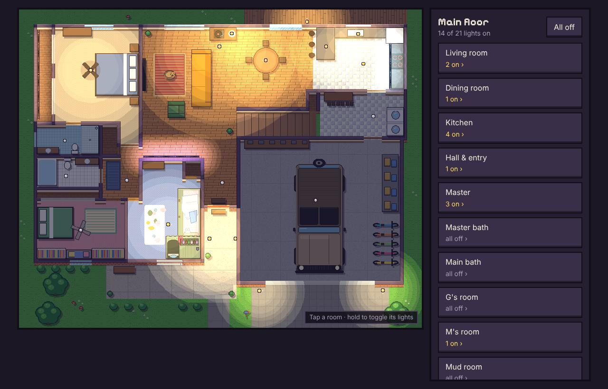

# pixel-home-assistant

A top-down pixel art map of the house (think early Zelda / Pokemon) that shows and toggles Home Assistant devices.
Plan: a standalone web component that runs as a Home Assistant custom card first, with a standalone site possible later.



## What's here so far

`maps/main-floor/`
- `main-floor.png` – the base art (888×704, 8 px per cell, 1 cell = 6 inches). Placeholder quality; repaint freely as long as the size stays the same.
- `main-floor.json` – the tile grid (walls, doors, windows, floors) and room rectangles. The renderer uses it so light never glows through walls or closed doors.
- `lights.yaml` – every light: name, room, map position (or several `fixtures` when one entity drives more than one) and a **placeholder** Home Assistant entity id. Replace the `entity:` values with your real ones.
- `preview.html` – self-contained interactive preview with mock state. Open it in a browser and tap a light.
- `build_map.py` – generates the PNG and JSON from the traced layout and sprite code.
- `build_preview.py` – inlines the PNG, JSON and YAML into `preview.html`.

Rebuild after changing anything:

```sh
cd maps/main-floor
python3 build_map.py      # needs Pillow
python3 build_preview.py  # needs PyYAML
```

## Controls

Tap a room to zoom into it. A panel lists everything in that room as big toggles: lights, fans, blinds, and color presets for RGB strips. It sits below the map on a phone and beside it on desktop. You can also tap fixtures directly on the zoomed map. Long-press a room on the overview to toggle all its lights. Rooms are defined under `rooms:` in `lights.yaml`.

## How lights render

Rooms get a dusky "night" tint. A light that is on cuts that tint away with a stepped (pixel-style) radial glow plus a warm overlay, clipped to the space it can actually reach.
It fades in and out over about half a second and flickers gently while on.
